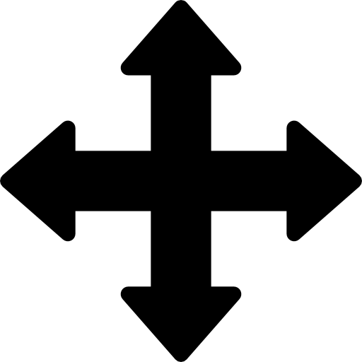

# Configurador 3D de Móveis Paramétricos

Configurador 3D de móveis sob medida construído para o Trabalho de Conclusão de Curso (TCC): objetos paramétricos criados no **Grasshopper** são carregados no navegador com **ShapeDiver** e **Three.js**, dentro de uma sala virtual com interação, múltiplos móveis simultâneos e estimativa de preço em tempo real.

## Funcionalidades

- **Sala virtual em metros** — piso, paredes e culling dinâmico conforme a câmera (modo dollhouse); móveis ancorados no chão.
- **Múltiplos móveis simultâneos** — modelo principal + catálogo para adicionar peças em tempo real, cada uma com sua própria unidade de modelo (`mm`/`cm`/`m`/`in`/`ft`, convertida sozinha para o cm da sala).
- **Mover e girar por peça** — arrasto no piso com trava nas paredes; slider de rotação −180°..180° com snap.
- **Cotas por peça selecionada** — 3 medidas que acompanham a câmera; sem seleção, mostra a cena toda.
- **Spawn inteligente** — peça nova nasce em ponto livre (espiral com checagem de sobreposição), uma única vez; rebuild após customize volta ao ponto e giro antigos (memória por sessão).
- **Câmera livre** — botão esquerdo orbita, botão direito desloca (pan XY), scroll aproxima/afasta, com limites de ângulo e distância.
- **Preço estimado total** — soma de todas as sessões, cada uma com sua própria regra de preço, com restrições e avisos na tela.
- **Filtro automático de cenário** — peças espúrias do modelo (piso espelhado, decoração) são excluídas da escala, das cotas e da ocupação.

## Começar rápido

1. **Catálogo:** copie `js/catalog.example.js` para `js/catalog.js` e preencha `ticket`/`modelViewUrl` de cada modelo.
2. **Configuração:** copie `js/config.example.js` para `js/config.js` (para começar, não precisa editar).
3. **Servidor local** na pasta do projeto:

```powershell
py -m http.server 8080
```

4. Abra `http://localhost:8080`.

> O ticket de exemplo do ShapeDiver só responde em `localhost:8080`. Para outro domínio/porta, cadastre o domínio no painel do ShapeDiver.
> `js/config.js` e `js/catalog.js` **não são versionados** porque podem conter tickets reais. Quem clonar o projeto deve copiar os dois `.example.js`.
> Se os seus tickets forem públicos, remova `js/catalog.js` do `.gitignore` para versioná-lo.

## Estrutura

```
index.html              Página principal (sidebar + viewer)
css/styles.css          Layout, controles, etiquetas de cota
assets/                 Ícones dos botões de mover/girar
js/catalog.example.js   Modelo do catálogo — copie para catalog.js
js/catalog.js           (local, não versionado) Tickets, modelos e preços
js/config.example.js    Modelo de configuração — copie para config.js
js/config.js            (local, não versionado) Configuração do módulo
js/viewer-loader.js     Carrega o viewer (bundle local primeiro, CDN depois)
js/shapediver.js        Sessões, parâmetros e envio com debounce (multi-sessão)
js/room.js              Sala, escala/filtro/spawn/cotas por sessão, memória de pose
js/camera.js            Órbita nativa + pan XY + dolly customizados
js/menu.js              Sidebar: registro/seleção de móveis por sessão
js/furniture-move.js    Modo mover (arrasto no piso)
js/furniture-rotate.js  Modo girar (slider com snap)
js/furniture-add.js     Catálogo: adiciona móveis em tempo real
js/constraints.js       Regras de restrição dos parâmetros
js/pricing.js           Estimativa de preço
js/main.js              Controles genéricos (sliders, dropdowns, cores) e status
js/vendor/              (não versionado) bundles locais para redes sem CDN
```

## Catálogo (`js/catalog.js`)

O arquivo define um único objeto global, `window.SD_CATALOG`. Ele é a **única fonte de verdade** para ticket, modelos, catálogo e preço por modelo. O `js/config.js` apenas lê esse objeto e monta o `window.SD_CONFIG`.

### Campos de cada modelo

| Campo | Obrigatório | Descrição |
| --- | --- | --- |
| `id` | sim | Identificador único, sem espaços. É a base do id de cada instância (`Armario-1`, `Armario-2`...). |
| `label` | não | Nome exibido no botão e no título. Se omitido, usa o `id`. |
| `ticket` | sim | Ticket do modelo no ShapeDiver. |
| `modelViewUrl` | sim | URL do servidor do modelo (ex.: `https://sdr7euc1.eu-central-1.shapediver.com`). |
| `modelUnits` | não | Unidade nativa do modelo: `mm`, `cm`, `m`, `in` ou `ft`. |
| `startup` | não | `true` carrega junto com a página (cena inicial). |
| `addable` | não | `true` aparece em **Adicionar móvel**. |
| `price` | não | Regra de preço deste modelo. Se omitido, usa `SD_CATALOG.price`. |
| `price.basePrice` | não | Valor fixo somado ao preço. |
| `price.pricePerCubicMeter` | não | Preço por m³. |
| `price.priceDimensions` | não | Nomes dos parâmetros usados como dimensões (ex.: `["Length"]`). |

### Exemplo: adicionar uma cadeira ao catálogo

```js
{
  id: "cadeira",
  label: "Cadeira",
  ticket: "COLE_O_TICKET_DA_CADEIRA",
  modelViewUrl: "https://sdr7euc1.eu-central-1.shapediver.com",
  modelUnits: "cm",
  startup: false,
  addable: true,
  price: {
    basePrice: 250,
    pricePerCubicMeter: 80,
    priceDimensions: ["Width", "Depth", "Height"]
  }
}
```

### Exemplo: preço diferente por modelo

```js
price: {
  basePrice: 899,
  pricePerCubicMeter: 150,
  priceDimensions: ["Length"]
}
```

### Exemplo: dois modelos na cena inicial

```js
models: [
  { id: "mesa", label: "Mesa", ticket: "...", modelViewUrl: "...", modelUnits: "cm", startup: true },
  { id: "cadeira", label: "Cadeira", ticket: "...", modelViewUrl: "...", modelUnits: "cm", startup: true }
]
```

### Regras

- O **primeiro** modelo com `startup: true` é o modelo principal (título da página e sessão inicial).
- Se nenhum modelo tiver `startup: true`, o **primeiro da lista** é carregado como principal.
- Um modelo pode ter `startup: true` e `addable: true` ao mesmo tempo.
- O mesmo `ticket` pode ser usado em vários modelos/instâncias; o que precisa ser único é o `id`.
- `price` é opcional. O que não for declarado no modelo é herdado de `SD_CATALOG.price`.
- `currency` é global (os preços de todos os modelos são somados na mesma moeda).
- `emptyLabel` (opcional) define o título quando a sala abre vazia (padrão: `Sala vazia`).

### Abrir a sala vazia ou com um modelo escolhido

O configurador aceita dois parâmetros na URL:

| URL | Efeito |
| --- | --- |
| `index.html` | Abre com os modelos marcados `startup: true` (comportamento padrão). |
| `index.html?model=Armario` | Abre com o modelo de `id: "Armario"` como principal, **substituindo** o startup. |
| `index.html?empty=1` ou `index.html?model=none` | Abre a sala sem nenhum móvel; o catálogo continua disponível. |

Exemplo de link em uma página anterior (vitrine):

```html
<a href="configurador.html?model=cadeira">Configurar esta cadeira</a>
```

O valor de `model` é o `id` do modelo em `js/catalog.js`. Se o id não existir, o configurador usa o startup padrão e avisa no console.

### Precedência do `?model`

O parâmetro `?model=<id>` tem prioridade sobre `startup: true`:

- Ele **substitui** o modelo inicial; não soma. Com `?model=Armario`, somente o modelo `Armario` é carregado — os modelos com `startup: true` não são carregados.
- O título e o preço principal passam a ser os do modelo escolhido.
- O modelo de startup só aparece depois se também tiver `addable: true` (aí fica em **Adicionar móvel**). Se for apenas `startup: true`, ele não aparece em lugar nenhum nessa URL.
- Se o id não existir, o parâmetro é ignorado, o startup padrão é usado e um aviso é registrado no console.
- `?empty=1` e `?model=none` também substituem o startup: a sala abre sem nenhum móvel.

Para carregar o startup padrão **e também** o móvel clicado, seria preciso outra regra (por exemplo, `?add=<id>`); o `?model` atual é uma escolha exclusiva.

## Configuração do módulo (`js/config.js`)

O `js/config.js` não contém mais tickets. Ele lê `window.SD_CATALOG` e expõe `window.SD_CONFIG` com as configurações que não são do catálogo:

| Chave | Descrição |
| --- | --- |
| `viewer.version` | Versão do Viewer do ShapeDiver (padrão `3.21.2`). |
| `viewer.onlyLocal` | `true` ignora o CDN e usa só `js/vendor/`. |
| `canvasId` | Id do `<canvas>` (padrão `canvas`). |
| `room.widthM/depthM/heightM` | Dimensões da sala em metros. |
| `room.modelUnits` | Unidade padrão quando o modelo não declara `modelUnits`. |
| `room.furnitureScale` | (opcional) Trava a escala manual e ignora `modelUnits`. |
| `room.maxFurniturePieceCm` | (opcional, padrão 400) Teto absoluto por peça no filtro. |
| `room.hideScenery` | Oculta decoração do modelo. |
| `room.wallCulling` | Paredes somem conforme a câmera (`enabled`, margens, opacidades). |
| `room.debug` | Painel de medição chão × pés na tela. |
| `camera.polarMin/polarMax/zoomMin/zoomMax` | Limites de órbita e distância. |
| `controls.ignore` | Parâmetros ocultos da sidebar. |
| `controls.groups` | Seções colapsáveis: `defaultCollapsed`, `collapsed[]`, `expanded[]` por nome exato. |

## Colocar o módulo em uma página nova

### 1. Copie os arquivos

Copie as pastas `css/`, `js/` e `assets/` para o lado da sua página nova. Mantenha a mesma estrutura relativa (ou ajuste os `src`/`href`).

### 2. Use a estrutura HTML mínima

Os IDs abaixo são usados pelo JavaScript. Se você renomear algum, atualize o código correspondente (ou mantenha os nomes).

```html
<!DOCTYPE html>
<html lang="pt-BR">
<head>
  <meta charset="UTF-8">
  <meta name="viewport" content="width=device-width, initial-scale=1.0">
  <title>Meu configurador</title>
  <link rel="stylesheet" href="css/styles.css">
</head>
<body>
  <header class="topbar">
    <h1 id="product-name">Configurador de Móveis 3D</h1>
  </header>

  <main class="layout">
    <aside id="side-panel" class="panel">
      <h2 id="side-panel-title">Atributos do móvel</h2>

      <div id="float-actions">
        <div id="rotate-panel" style="display:none;">
          <label class="control-label" for="rotate-slider">
            Rotação <span id="rotate-value" class="control-value">0°</span>
          </label>
          <input id="rotate-slider" class="control-slider" type="range"
                 min="-180" max="180" step="1" value="0">
        </div>
        <button id="move-toggle" class="fab" type="button" title="Mover móvel" aria-label="Mover móvel">
          
          <span aria-hidden="true">⤢</span>
        </button>
        <button id="rotate-toggle" class="fab" type="button" title="Rotacionar" aria-label="Rotacionar">
          
          <span aria-hidden="true">⟳</span>
        </button>
      </div>

      <div class="price-box">
        <span>Preço estimado:</span>
        <strong id="price">-</strong>
      </div>

      <div id="side-panel-body"></div>
      <ul id="warnings" class="warnings"></ul>

      <div id="add-model">
        <h2>Adicionar móvel</h2>
        <div id="catalog-list"></div>
        <div id="add-model-status" class="control-hint"></div>
      </div>
    </aside>

    <section class="viewer-wrap">
      <div id="canvas-container">
        <canvas id="canvas"></canvas>
      </div>
      <div id="overlay">
        <p>Carregando modelo 3D...</p>
      </div>
    </section>
  </main>

  <script src="js/catalog.js"></script>
  <script src="js/config.js"></script>
  <script src="js/viewer-loader.js"></script>
  <script src="js/shapediver.js"></script>
  <script src="js/constraints.js"></script>
  <script src="js/pricing.js"></script>
  <script src="js/main.js"></script>
  <script src="js/room.js"></script>
  <script src="js/camera.js"></script>
  <script src="js/menu.js"></script>
  <script src="js/furniture-move.js"></script>
  <script src="js/furniture-rotate.js"></script>
  <script src="js/furniture-add.js"></script>
</body>
</html>
```

### 3. Mantenha a ordem dos scripts

A ordem importa:

1. `catalog.js` — define `window.SD_CATALOG`.
2. `config.js` — lê o catálogo e monta `window.SD_CONFIG`.
3. `viewer-loader.js` — lê `SD_CONFIG.viewer` **na hora** e começa a carregar o Viewer.
4. `shapediver.js`, `constraints.js`, `pricing.js`, `main.js`.
5. `room.js`, `camera.js`, `menu.js`, `furniture-move.js`, `furniture-rotate.js`, `furniture-add.js`.

O `main.js` espera o `DOMContentLoaded`; os demais esperam o evento `sdv-ready` disparado depois que as sessões são criadas.

### 4. Edite só o catálogo

Para trocar móveis, tickets, unidades ou preços, edite `js/catalog.js`. Não é preciso mexer no HTML nem nos outros arquivos.

## Preço por modelo

Cada sessão usa a regra de preço do seu modelo:

```
preço = basePrice + volume * pricePerCubicMeter
volume = produto dos valores dos parâmetros listados em priceDimensions
```

- Se `priceDimensions` estiver vazio, `volume` vale `1` (o preço vira `basePrice + pricePerCubicMeter`).
- Se `pricePerCubicMeter` for `0`, o preço é só `basePrice`.
- O valor exibido é a **soma** de todas as sessões (modelo principal + modelos adicionados).
- `currency` define a moeda da tela (padrão `BRL`).

## Controles genéricos (contrato com o modelo)

A sidebar monta os controles **a partir dos metadados do próprio modelo** — nenhum móvel precisa de configuração individual. Para um modelo novo se comportar bem, ele precisa expor:

| Metadado | Efeito | Se ausente |
| --- | --- | --- |
| `param.order` (número) | Ordem dos controles na sidebar | Mantém a ordem de chegada do modelo |
| `param.group.name` | Cabeçalho de seção agrupando controles | Controles aparecem sem cabeçalho |
| `param.choices` | Lista de opções | Numérico vira slider; texto sem opções **não renderiza** (ver limitação) |
| `modelUnits` (`mm`/`cm`/`m`/`in`/`ft`, no `catalog.js` ou `room.modelUnits`) | Conversão automática para o cm da sala | Assume a unidade global da sala |

Regras de renderização (iguais para todo móvel):

- Escolhas de cor → botões swatch; demais escolhas → dropdown.
- Numéricos → slider (inteiro detectado sondando `isValid`, sem depender do tipo declarado).
- Booleanos → checkbox; `file` e grupos `export`/`email` → ocultos.

**Limitações conhecidas:**

1. **Envio de escolhas espelha o formato atual.** Alguns `StringList` guardam o índice (`"0"`) em vez do texto (`"Shelves"`). O código detecta isso pelo valor atual do parâmetro e envia no mesmo formato **e tipo** (string `"1"` ou número `1`). Se um modelo futuro guardar as opções num terceiro formato, o `setParameter` será rejeitado com `isValid ... is not of type ...` no console — ver `choiceSendValue` em `js/main.js`.
2. **Parâmetro `String` sem opções nem min/max não gera controle.** Ex.: caminho de textura avulso. Seria necessário um campo de texto (`buildText`, ainda não implementado).
3. **Diagnóstico:** com `window.__DIM_VERBOSE = true` no console, os logs `[SCALE]/[SPAWN]/[EVICT]/[FILTRO]/[DIM-MESH]` mostram escala, spawn, expurgo, filtro de peças e composição das cotas. Em uso normal o console fica limpo (só erros).

## Solução de problemas

| Sintoma | Causa provável | O que fazer |
| --- | --- | --- |
| `Please whitelist domain 'localhost:8080'` | O domínio não está liberado no ShapeDiver. | Cadastre o domínio/porta no painel do ShapeDiver ou use `localhost:8080`. |
| `window.SD_CATALOG nao encontrado` | `catalog.js` não foi carregado ou está depois do `config.js`. | Coloque `<script src="js/catalog.js"></script>` antes de `config.js`. |
| `Ticket e Model URL sao obrigatorios` | Modelo sem `ticket`/`modelViewUrl` no `catalog.js`. | Preencha os dois campos. |
| `Nenhuma fonte do viewer disponivel` | CDN bloqueado e sem bundle local. | Use `viewer: { onlyLocal: true }` com `js/vendor/sdv.bundle.local.js` ou libere o CDN. |
| Preço `R$ 0,00` ou `NaN` | `price`/`basePrice` ausente ou dimensão com valor não numérico. | Confira `price` no `catalog.js`, os nomes em `priceDimensions` e se os parâmetros são numéricos. |
| Móvel gigante ou minúsculo | `modelUnits` errado. | Ajuste `modelUnits` no `catalog.js` (`mm`, `cm`, `m`, `in`, `ft`). |
| Código antigo depois de editar | Cache do navegador. | DevTools (F12) → Network → **Disable cache** e recarregue. |

## Tecnologias

- ShapeDiver Viewer v3.21.2 (API + Three.js embutido)
- Three.js r160 (cópia separada para utilitários — há warning de instância duplicada, sem impacto funcional)
- JavaScript puro (sem frameworks)
- Python `http.server` para o servidor local
